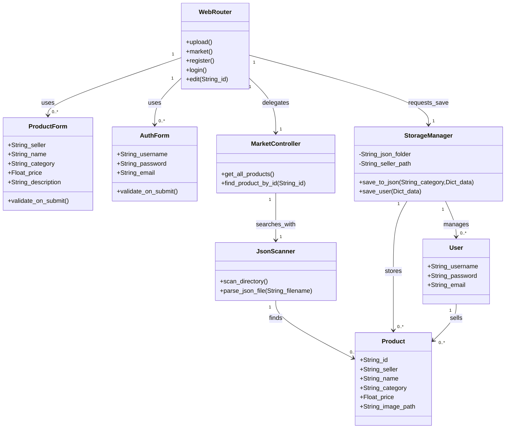
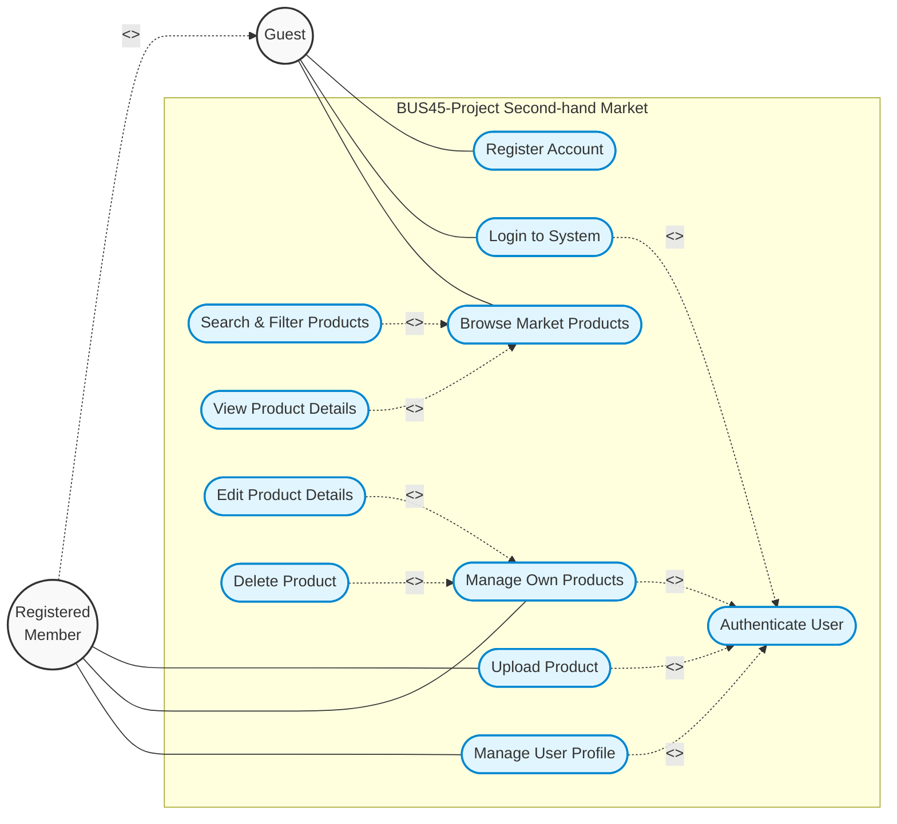
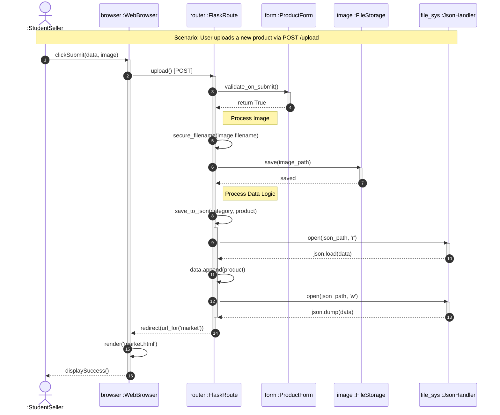
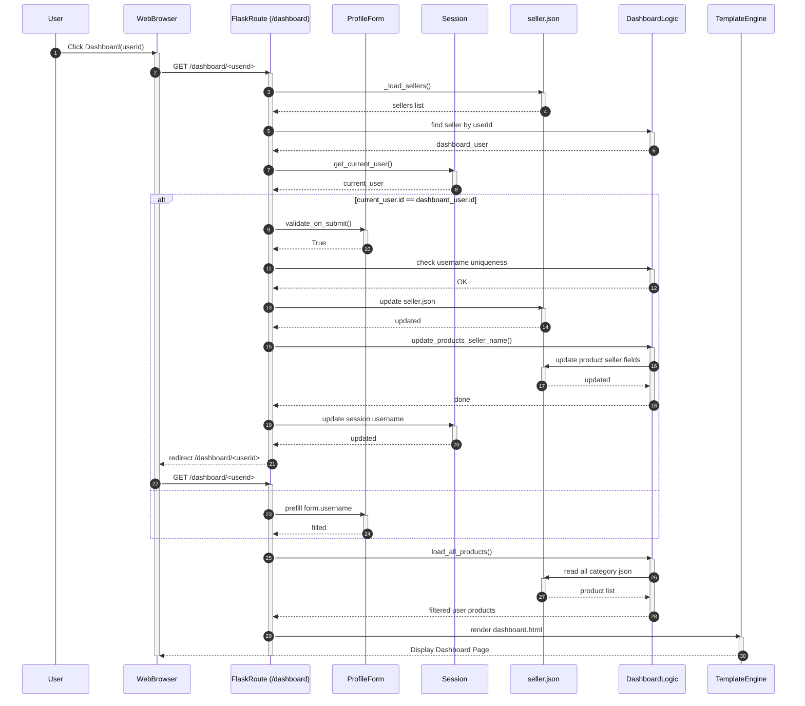
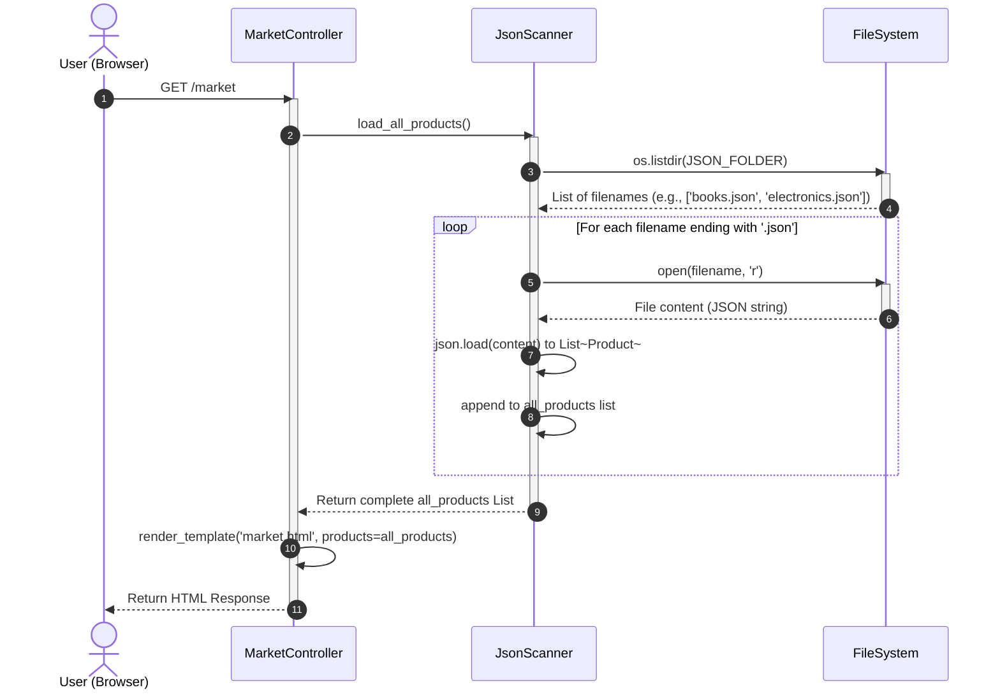

# Secondhand Marketplace

Upload of the **UseableSoftware** team project (UoB BUS45 coursework).

## Run locally

### Requirements
- Python 3.10+
- Dependencies:

```bash
pip install flask flask-sqlalchemy flask-wtf email-validator werkzeug pytest
```

### Start the server

From the project root:

```bash
python3 -c "from app import app; app.run(host='127.0.0.1', port=3000, debug=True)"
```

Open [http://127.0.0.1:3000](http://127.0.0.1:3000)

### Run tests

```bash
pytest -v
```

Tests use Flask's test client and a temporary SQLite database (they do not touch `instance/market.db`).

| File | Covers |
|------|--------|
| `tests/test_s1_upload_list.py` | Upload + list (S1) |
| `tests/test_s2_profile.py` | Password / edit / delete (S2) |
| `tests/test_s3_search.py` | Search + filters (S3) |

### Class Diagram



### Use Case Diagram


### S1 Post Item - Sequence Diagram





### S2 User Profile - Sequence Diagram





### S3 Search and Classification - Sequence diagram



